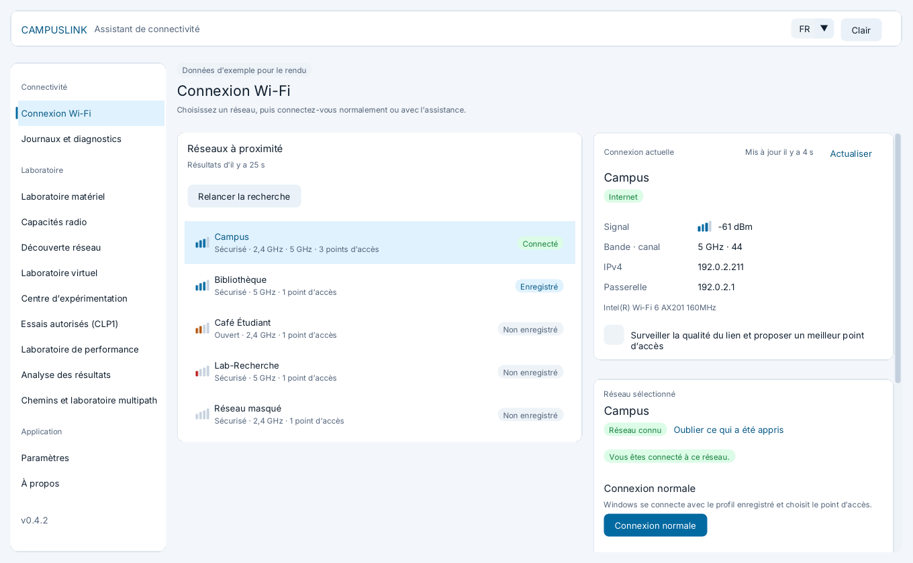

# CAMPUSLINK

Assistant de connexion Wi-Fi pour **Windows 11 x64**. L’application s’ouvre sur **Connexion Wi-Fi** : recherchez les réseaux, sélectionnez-en un et lancez la **Connexion normale** ou la **Connexion assistée directe**. Les étapes affichées (association, adresse IP, Internet) sont celles que Windows confirme ; chaque échec indique sa cause et l’action utile. Windows conserve la gestion des identifiants, du portail et des adresses IP.

**EN.** CAMPUSLINK is a native Wi-Fi connection assistant. It opens on **Wi-Fi connection**: search, select a network, then connect normally or with assistance. Progress follows what Windows confirmed; failures state their cause and next step. Extract the whole portable ZIP and run `CampusLink.exe` next to `SDL3.dll`. Vulkan is preferred; SDL software rendering is the fallback.



## Build

Release build — LLVM and Visual Studio C++ Build Tools with a Windows 11 SDK, hash-locked dependencies:

```powershell
powershell.exe -NoProfile -ExecutionPolicy Bypass -File scripts\setup-deps.ps1 -InstallPinnedLLVM
.\build.bat doctor
.\build.bat test
.\build.bat release-all
```

Build logs: `logs/build/`. Portable ZIP: `dist/packages/`. [Build](docs/BUILD_WINDOWS.md) · [Distribution and checksums](docs/BUILD_RELEASE.md).

Developer build without Visual Studio (MSYS2 UCRT64 clang + SDL3, Dear ImGui sources in `third_party/imgui`): `powershell -File scripts\dev-mingw.ps1` builds and runs the unit tests. It is not the release toolchain.

## Documentation

[User guide (FR/EN)](docs/USER_GUIDE.md) · [Architecture](docs/ARCHITECTURE.md) · [ADR 0004 — connection-first](docs/decisions/0004-connection-first-and-link-quality.md) · [ADR 0003 — reliability](docs/decisions/0003-connection-reliability-and-workspace.md) · [ADR 0002 — transport](docs/decisions/0002-connectivity-evidence.md) · [Audit 0.4.0/0.4.1](docs/reports/AUDIT_0.4.0_0.4.1.md) · [Performance 0.4.2](docs/reports/PERF_0.4.2.md) · [Known limitations](docs/KNOWN_LIMITATIONS.md) · [Windows 11 field validation](docs/WINDOWS11_VALIDATION.md)

The research lab (scoped CLP1 measurements, Virtual Client Lab, multipath scheduler models) is separate and opt-in. It does not simulate radio capability and forwards no Internet traffic.
